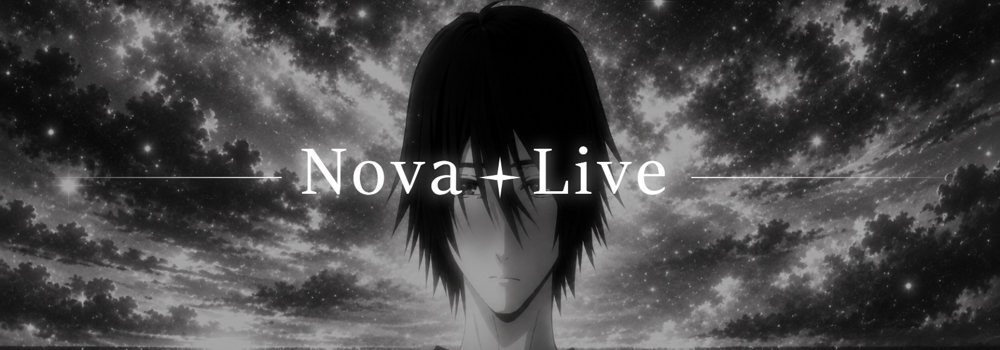

<p align="center"></p>

<p align="center">Live wallpapers for Windows, made by Nova Studios. Paste a link and it plays behind your desktop icons.</p>

---

Nova Live turns almost anything into your desktop background. Paste a YouTube link and it downloads the video and plays it on a loop behind your icons, on every screen. It also works with TikTok and most other video sites, pictures, GIFs, video files on your PC and whole web pages.

## Features

- **Paste a link, get a wallpaper.** YouTube, TikTok, Instagram, Twitter/X, Pinterest and the many other sites [yt-dlp](https://github.com/yt-dlp/yt-dlp) supports. Videos are saved in your library, so they play smoothly and work offline
- **Pictures, GIFs and web pages too.** A direct picture link, or any page (a clock, a shader, a live YouTube stream) runs as the wallpaper
- **Drop files** from your PC onto the window, or press **Browse**
- **Library** with thumbnails. Click one to put it on, rename it, or remove it (it goes to the Recycle Bin)
- **Auto next:** move on to the next wallpaper when the video ends, or every 1, 5, 10, 30 or 60 minutes, in order or shuffled
- **Bring in your Nova Grid backgrounds** with one click
- **Pauses by itself** while a game or full-screen app is open, so it doesn't cost you frames
- Sound on or off with a volume slider, plus Fill, Fit or Stretch
- Lives in the tray by the clock, and can start with Windows
- See-through glass over the Nova Live artwork. **Settings → Look** sets how see-through it is and how much blur

## Install

1. Download **Nova-Live-Setup-1.0.0.exe** from the [latest release](https://github.com/Acuz3D/nova-live/releases/latest) and run it.
2. For links, install the free downloader yt-dlp (and ffmpeg for the best quality) by running this in a terminal:
   ```
   winget install yt-dlp
   ```
   Files and pictures on your PC work without it.

Your library and settings are kept in `%APPDATA%\Nova Live`.

## Run from the code

```
npm install
npm start
```

`npm run dist` builds the installer into `dist`, and `npm run icon` remakes the icon, background and banner from the artwork in `art`.
